<div align="center">



<br/><br/>

<a href="https://github.com/mhrshadfm"></a>


</div>

<br/>

```text
╔═════════════════════════════════════════════════════════════════════════════════════════════╗
║  SYS_ID: 0x23 // SPECIFICATION SHEET                                                        ║
║  STATUS: SOVEREIGN_LOCAL_FIRST                                                              ║
║  KERNEL: LOCAL SILICON INFERENCE · NLE TIMELINE AUTOMATION · EXISTENTIAL NARRATIVE ENGINES  ║
╚═════════════════════════════════════════════════════════════════════════════════════════════╝
```


Systems Architect & Full-Stack Engineer with a track record of translating complex multi-modal ideas from first-principles architecture into hardened, production-grade software.

Currently engineering **Viral Studio**, a macOS Sequoia-inspired AI cinema pre-production & NLE pipeline bridging Next.js 15, FastAPI, FCP7 XML, and After Effects automation. Alongside video tooling, I build autonomous cognitive engines like **FuY.Land** (local-first cognitive synthesis running on RTX silicon and Qdrant vector memory) and **OSINT-Sentinel** (enterprise multi-platform social graph intelligence with 24/7 stream archival).

Beyond code, I explore the architecture of human memory, build a Digital Ideal Twin AI, **Henaseh (هناسه)**, and publish empirical cognitive psychology research.

I combine deep technical craftsmanship with strategic systems thinking: architecting local-first sovereign AI pipelines, reverse-engineering complex multimedia workflows across Adobe and TouchDesigner, and translating intricate human cognition into resilient, zero-hype software.

<br/>




<details>
<summary><code>▸ READ AS PLAIN TEXT</code></summary>

<br/>

| System | Architecture & Core Tech | Specification & Capabilities |
| :--- | :--- | :--- |
| **Viral Studio** | Next.js 15, React 19, FastAPI, SQLite, Premiere XML | macOS glassmorphic pre-production engine, Premiere Pro magnetic timeline, AE V1–V12 layer inspector, RTL/LTR script editor, and cadence WPS engine. |
| **FuY.Land** | Python, Ollama (RTX Local LLMs), Qdrant Vector DB | Autonomous cognitive synthesis engine. Decodes live signals across AI, cognitive psychology, and platform dynamics with anti-PR quality gates. |
| **OSINT-Sentinel** | Python, FastAPI, FFmpeg, NetworkX, Interactive Graph | Multi-platform intelligence tracker, live HLS broadcast recording daemon, network centrality metrics, and anti-detection jitter engines. |
| **Spaces** | Electron, Node.js, Windows 11 / macOS UI | Multi-account isolated application runner with isolated cookie/session sandboxing and clean desktop virtualization. |
| **Silk Road Core** | FastAPI, SQLite, Cloudflare Tunnels, Telegram WebApp | Mathematical multi-tier affiliate referral architecture with geometric commission decay and privacy-preserving downline indexing. |

</details>

<br/>


<div align="center">

`░▒▓ LANGUAGES`


`░▒▓ FRONTEND & DESKTOP`


`░▒▓ BACKEND & DATA`


`░▒▓ AI & SOVEREIGN COMPUTE`


`░▒▓ CREATIVE TECH & AUDIO/VISUAL`


`░▒▓ DEVOPS & TOOLS`


</div>

<br/>




<p align="center"><sub>Every building is one day of commits. Taller means more. Rebuilt every night by a GitHub Action.</sub></p>

<br/>


```yaml
[ SPEC // 0x23_COGNITION ]
-----------------------------------------------------------------------------------------
🧠 Interests     → Local-First AI · Cognitive Psychology · Systems Architecture
💪 Training      → Systems Thinking · Heavy Resistance Training · Radical Cognitive Anti-Fragility
📈 Intelligence  → OSINT Graph Dynamics · High-Signal Synthetics
🌐 Languages     → English (C2 Proficient) · Persian (Native) · Kurdish (Sorani/Ardalani) · Russian (Elementary)
```

<br/>

<div align="center">

<em>"Local sovereignty and systemic cognition to solve problems by building."</em>

<br/><br/>



</div>
